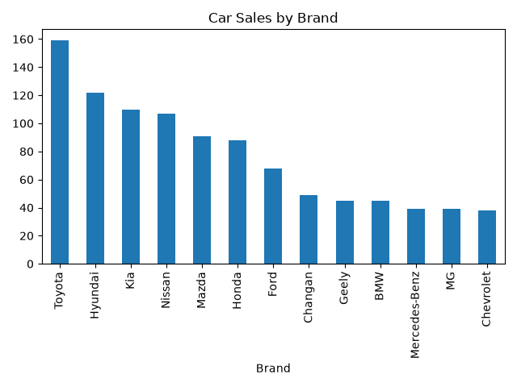
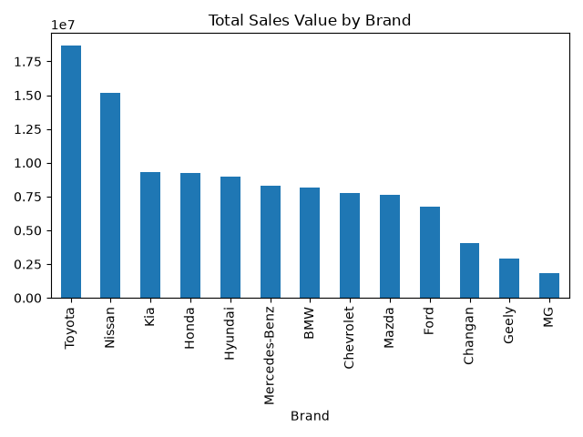
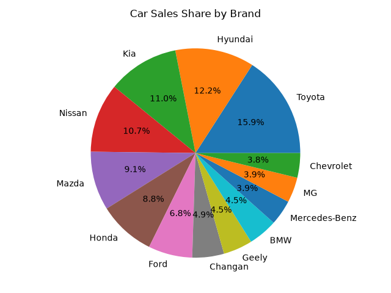

# Car Sales Analysis

A Python project for analyzing a dataset of 1,000 car records using Pandas and Matplotlib.

The project focuses on data cleaning, data analysis, and data visualization to understand car sales patterns and compare different car brands.

## Project Objectives

- Analyze car sales data using Python.
- Check for missing values and duplicate records.
- Calculate average, total, and maximum car prices.
- Identify the most common car brands and models.
- Compare total sales value across car brands.
- Visualize the results using charts.

## Tools Used

- Python — Programming language.
- Pandas — Data analysis and manipulation.
- Matplotlib — Data visualization.
- OpenPyXL — Reading Excel files.

## Dataset

The dataset contains 1,000 car records stored in an Excel file named `cars1000.xlsx`.

The analysis uses the following columns:

- `Brand` — Car manufacturer.
- `Model` — Car model.
- `Price` — Car price.

## Data Cleaning

Before analyzing the data, I checked for missing values and duplicate rows.

**Results:**

- Missing Values: 0
- Duplicate Rows: 0

No missing values or duplicate rows were found.

## Analysis Results

| Metric | Result |
|---|---|
| Total Cars | 1,000 |
| Average Price | 108,794.9 |
| Total Sales Value | 108,794,900 |
| Highest Price | 413,400 |
| Most Common Brand | Toyota |
| Toyota Records | 159 |
| Missing Values | 0 |
| Duplicate Rows | 0 |

### Car Counts by Brand

| Brand | Number of Cars |
|---|---:|
| Toyota | 159 |
| Hyundai | 122 |
| Kia | 110 |
| Nissan | 107 |
| Mazda | 91 |
| Honda | 88 |
| Ford | 68 |
| Changan | 49 |
| Geely | 45 |
| BMW | 45 |
| Mercedes-Benz | 39 |
| MG | 39 |
| Chevrolet | 38 |

### Top 3 Brands by Total Sales Value

| Brand | Total Sales Value |
|---|---:|
| Toyota | 18,665,300 |
| Nissan | 15,155,200 |
| Kia | 9,286,100 |

## Data Visualizations

Three charts were created using Matplotlib.

### 1. Car Sales by Brand

This bar chart compares the number of car records for each brand.

### 2. Total Sales Value by Brand

This bar chart compares the total price value for each car brand.

### 3. Car Sales Share by Brand

This pie chart shows the percentage share of each brand based on the number of car records.

## Key Findings

- Toyota has the highest number of cars in the dataset, with 159 records (15.9%).
- Hyundai ranks second by number of cars, with 122 records.
- Toyota also has the highest total sales value at 18,665,300.
- Nissan ranks second in total sales value at 15,155,200.
- The dataset contains no missing values or duplicate rows.

## How to Run the Project

1. Install the required libraries:

   `pip install pandas matplotlib openpyxl`

2. Make sure `main.py` and `cars1000.xlsx` are in the same project folder.

3. Open a terminal in the project folder.

4. Run the Python script:

   `python main.py`

The script will analyze the dataset and display the charts.

## Project Files

- `main.py` — Python code for data cleaning, analysis, and visualization.
- `cars1000.xlsx` — Dataset.
- `results.md` — Detailed analysis results.
- `README.md` — Project documentation.
- `charts/` — Generated charts.

## What I Learned

Through this project, I practiced:

- Reading Excel files with Pandas.
- Exploring and cleaning datasets.
- Using `mean()`, `sum()`, `max()`, and `value_counts()`.
- Grouping data with `groupby()`.
- Sorting results using `sort_values()`.
- Creating bar charts and pie charts.
- Organizing and documenting a Python project.

## Future Improvements

- Analyze car prices by model.
- Compare average prices between brands.
- Explore additional features in the dataset.
- Create more advanced data visualizations.

---

- Author: Omar

- Project Type: Python Data Analysis

- Learning Journey: Becoming an AI Engineer